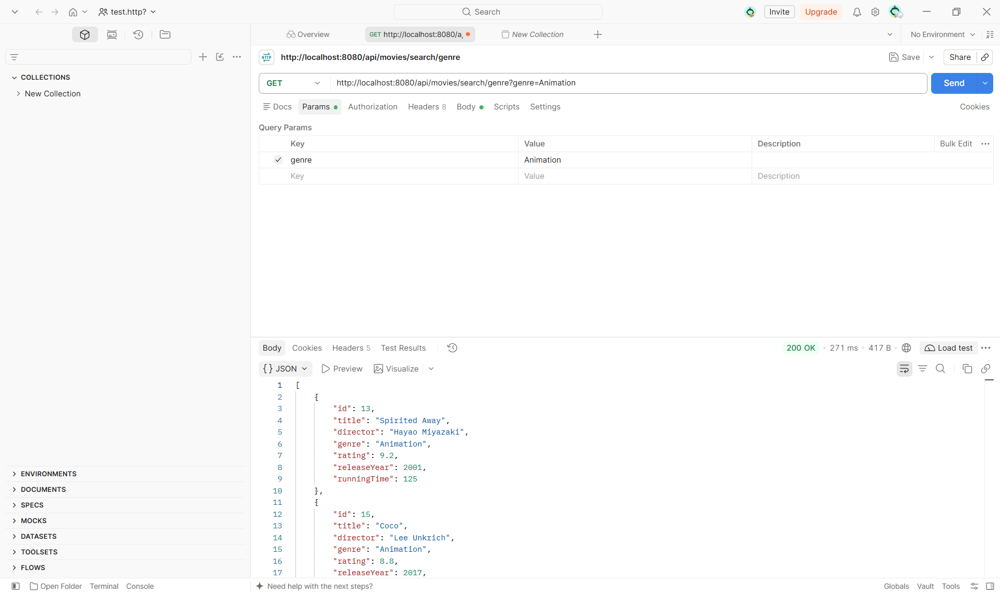
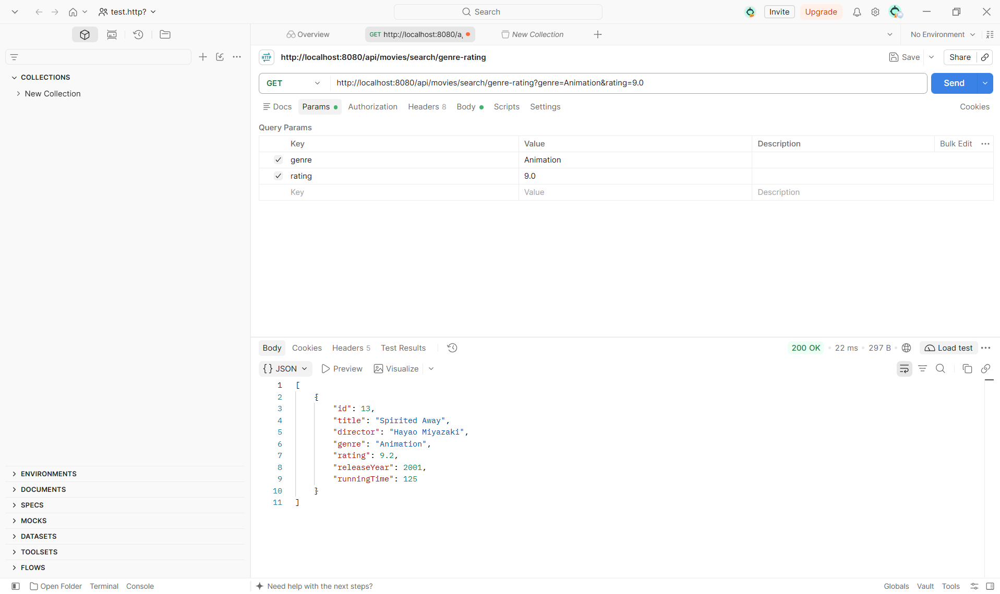
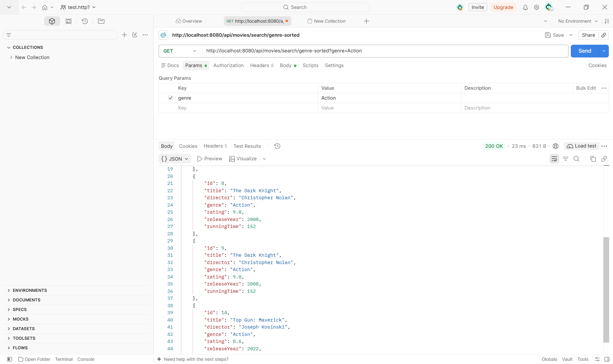
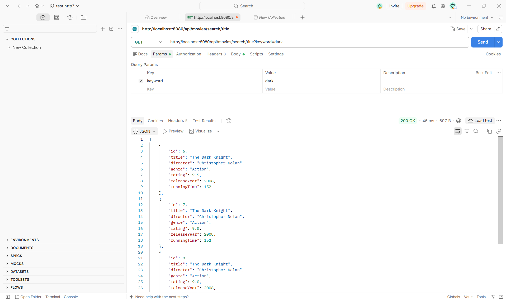
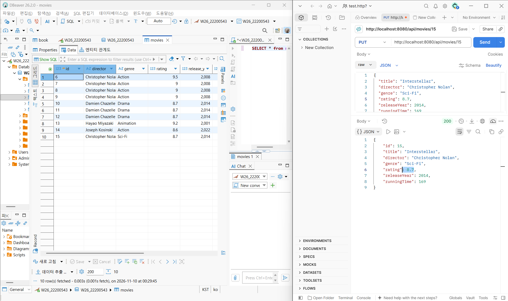
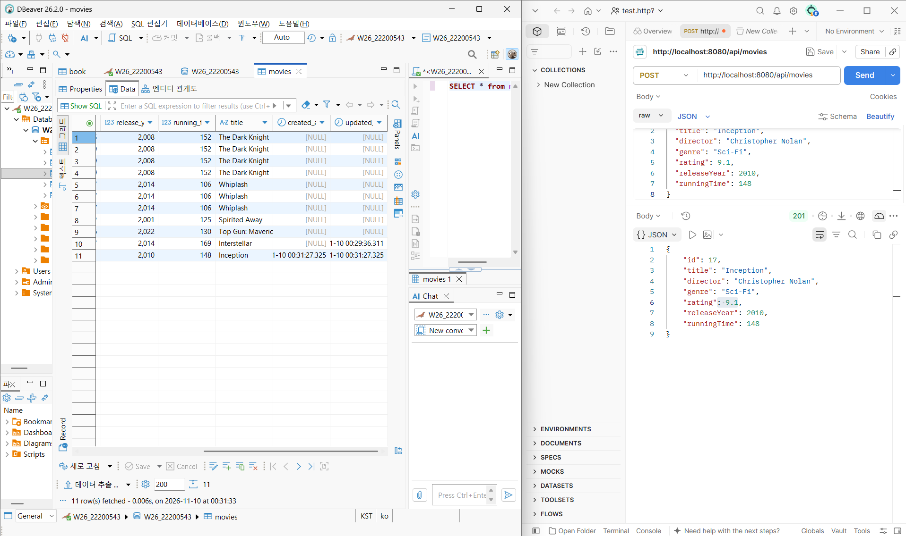

# 22200543 이어진 웹서비스 개발 01분반 10주차 과제

## 프로젝트 소개

1. 프로젝트 주제 및 주요 기능: Spring Boot와 Spring Data JPA 활용.  
    9주차에 간단한 CRUD기능 기반으로 Query Method, Dirty Checking, JPA Auditing 기능들을 추가  
2. GitHub Repository URL https://github.com/eojinleecode/22200543-assign10 
3. Render Deployment URL https://two2200543-assign10.onrender.com/api/movies  

## 주요 구현 내용 및 결과

Query Method 3개: 검색 조건 및 API 실행 결과 
 
 
 
 
Dirty Checking: 수정 기능 구현 및 실행 결과 

Auditing: 생성·수정 시간 자동 기록 결과 

.png)

##  Weekly Review

* Key Learning: 새롭게 배운 내용 2~3가지 
1. 다양한 검색 조건과 정렬 기능을 구현할 수 있다는 점을 학습하였다. 
2. 트랜잭션 안에서 객체의값을 변경 하면 Hibernate가 
    데이타값을 자동으로감지하여 알아서 SQL을 실행한다는 것을 학습하였다.  
3. JPA Auditing을 통한 @CreatedDate와 @LastModifiedDate 어노테잇션를 이용하면
    데이터 생성 및 수정 시간을 자동으로 체크할 수 있다는 점을 학습하였다. 

* Problem & Solution:  
  1. Problem: 9주차 프로젝트를 Clone한 후 IntelliJ에서 메인 클래스의 실행 버튼 실종. 
   solution: 실제 Gradle 프로젝트가 위치한 하위 디렉터리를 IntelliJ에서 다시 열어 프로젝트를 정상적으로 인식하도록 수정 
2. Problem: 마리아DB버전 ALTER TABLE IF EXISTS 구문SQL 문법 오류가 발생. 
    Solution: DBeaver에서 created_at, updated_at 컬럼을 직접 추가하여 테이블 구조를 수정. 
3. Problem: Render 배포 과정에서 데이터베이스 환경변수가 올바르게 설정되지 않아 'url' must start with "jdbc" 오류가 발생.
   Solution: Render의 Environment 설정에서 올바른 형식으로 수정하고 재배포 성공.

* Reflection: 프로젝트를 실행하는 과정에서는 이전 주차의 프로젝트를 Clone하면서
  발생한 IntelliJ 설정 문제와 MariaDB 버전 호환성 문제를 해결하는것에 좀 시간을 많이 썼던 것같다.
   그리고 10주차에 배운 Query Method를 활용하여 복잡한 SQL을 직접 작성하지 않고도 사용자의 조건에 따라 검색엔진같은 것을 구현할 수 있다는 점이 인상 깊었다.

##  AI Usage

1. 사용한 생성형 AI 도구 및 주요 질문 :챗지피티 사용

IntelliJ에서 프로젝트 실행 버튼이 나타나지 않는문제의 원인 및 해결 방법 질문 
MariaDB와 Hibernate 버전 호환성 문제에 대해질문 
Render 배포 과정에서 오류 및 해결 방법에 대해 질문 
2. AI가 제공한 내용 중 직접 수정하거나 검증한 부분 :  
3. AI 사용 비율에 대한 자기 평가: 30퍼센트 , 더 줄여보려고 애를 쓰긴 해야하나 셋업문제나 개발환경 문제 해결시간이 오래걸리면 사용하는 것이
   좋다고 개인적으로 생각합니다. 

 
